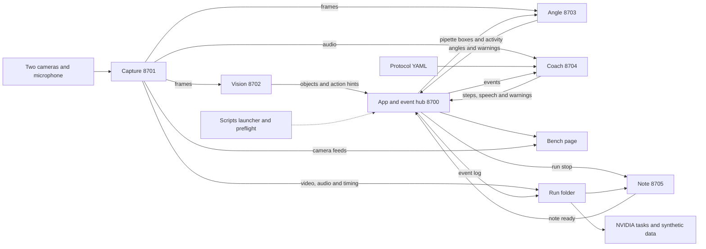

# Bench Coach

Bench Coach uses two cameras and a microphone to follow a pipetting protocol, show the next step, and flag possible technique mistakes. It turns recorded events and speech into a lab note with links back to the video.

Built by the team at the MIT ScienceClaw hackathon, October 30 to November 1, 2026, with AI coding agents. Everything in this repository was written during the hackathon.

## How the parts fit together



The [event contract](docs/EVENTS.md) defines the ports, events and shared Unix epoch clock. Capture writes `cam0.mp4`, `cam1.mp4`, `mic.wav` and `timing.jsonl` to `runs/<run>/`. The hub adds `events.jsonl`, and note builds the lab note when the run stops. Producers print undelivered events to stdout when the hub is down.

The coach follows the protocol from the event stream, listens through local speech recognition, counts spoken confirmations as "said" evidence, asks about vision hints in hint mode, and warns about reused tips, skipped steps and tilt. On the scripted demo it marked all 8 steps as planned and warned on all 3 planned mistakes; it has not yet been run with real vision, real capture and a real mic together. The launcher skips parts that are missing, so check the part dots on the page before a demo.

## Run the demo

Run from the repository root with the dependencies listed in each part installed. Set `BENCH_PY` to that Python executable, or leave it unset for `python3`. Set `BENCH_SAMPLES` to the folder holding the sample videos, which are not bundled. General vision downloads model weights on first use, so prepare those before presenting.

Choose one of these three commands. Stop it with Ctrl-C before starting another.

```sh
# Live cameras and microphone
./scripts/demo.sh --cams 0 1

# Looped sample videos and a silent microphone
./scripts/demo.sh --source "$BENCH_SAMPLES/lsv_mv/CP-Left-Front-414-445.mp4" "$BENCH_SAMPLES/lsv_mv/CP-Right-Front-414-445.mp4"

# Bundled synthetic event replay with no cameras or live producers
./scripts/demo.sh --replay app/samples/demo.jsonl --without capture vision angle coach note
```

Wait for **Demo ready**, then open <http://127.0.0.1:8700>. For live cameras or sample videos, review the protocol, choose **Start run**, then **Stop**, and open **Lab note**. Check that capture recorded as well as the hub logging events. Logs are in `runs/logs/`, and Ctrl-C stops the launcher's processes. Speaker playback is off by default.

The bundled replay shows synthetic steps, a question and an angle warning. Its camera panels stay empty and it produces no recording or lab note. It does not measure recognition. For a saved log containing run events, use the [app replay guide](app/README.md) with an existing hub instead. The launcher's direct replay retains run events, which the rebuilt hub rejects through its event endpoint.

Angle uses vision's pipette boxes by default. Supply `--angle-roi X,Y,W,H` for a manual shaft crop, once per camera used, and `--calibration angle/calibration.json` for your measured camera setup. Without usable calibration, angles are rough image projections. The [launcher guide](scripts/README.md) covers hints, table mode, recorded microphone input and custom ports.

## At the table

- [ ] Fix both cameras and confirm that each feed advances. Cover one lens at a time to check their identities. Keep demo ports 8700–8705 available and use 8800–8899 for separate checks.
- [ ] For table mode, bring an overhead camera, tubes A/B/C with red/blue/yellow caps respectively, a tip box, a waste cup, and a matte magenta band near the pipette tip above the liquid-contact area. Fix the rack and camera in place.
- [ ] Follow the [table setup commands](scripts/README.md#table-day). With caps closed and the pipette out of view, save the regions through capture's existing feed. Review every region. Start with `--table` for an overhead view in capture camera slot 0, the default table source. Table mode and hint mode cannot be combined.
- [ ] For physical tilt, follow the [calibration checklist](angle/CALIBRATE.md) with the level checkerboard, then complete the pencil check. Camera order and resolution must match the saved calibration. Do not move cameras afterward. Disable angle for a table-only demo if calibration is not ready.
- [ ] Run the [preflight check](scripts/README.md#table-day) against the running services. It checks fresh feeds, cap and band visibility, calibration, microphone transcription, part health, protocol and free disk. Apply each FIX and rerun. Use `--no-angle`, `--no-table` or `--no-mic` only for deliberately disabled checks.
- [ ] At the prompts, show the magenta band and say “testing”. Preflight needs cached Whisper weights and plays no sound. Open the caps afterward without moving the rack. Review the loaded protocol and its evidence rules, especially combined actions and tube names.
- [ ] Start and stop a short run. Confirm the recordings, lab note, video time links and downloads work. Preflight proves readiness, not recognition accuracy.

## Models, libraries and licences

This table gathers the parts' reported dependencies. The linked guides contain source URLs and details. Coach dependencies are provisional from its brief and the earlier draft until its implementation lands. SDK licences do not grant rights to hosted models, which follow provider terms.

| Part | Models and libraries | Reported licences |
| --- | --- | --- |
| Shared services | Python, FastAPI, Starlette, Pydantic, Uvicorn, HTTPX, websockets, PyYAML, pytest | Python PSF-2.0; FastAPI, Pydantic, PyYAML and pytest MIT; Starlette, Uvicorn, HTTPX and websockets BSD-3-Clause |
| [Capture](capture/README.md) | OpenCV, FFmpeg, NumPy, sounddevice, PortAudio, qrcode, OpenSSL | OpenCV Apache-2.0 with MIT wheel packaging; FFmpeg LGPL-2.1-or-later or GPL depending on build; NumPy and qrcode BSD-3-Clause; sounddevice and PortAudio MIT; OpenSSL 3+ Apache-2.0, older builds under OpenSSL/SSLeay terms |
| [Vision](vision/README.md) | MediaPipe Hand Landmarker, Grounding DINO tiny, Transformers, PyTorch, OpenCV, NumPy, Anthropic SDK | MediaPipe, Grounding DINO, Transformers and OpenCV Apache-2.0; PyTorch and NumPy BSD-3-Clause; Anthropic SDK MIT |
| [Angle](angle/README.md) | OpenCV LSD, CSRT and stereo calibration; NumPy | OpenCV Apache-2.0; NumPy BSD-3-Clause with bundled notices listed in the part guide |
| [Coach](coach/README.md) | faster-whisper, Whisper small.en, Silero VAD, Anthropic SDK, Google Gen AI SDK, sounddevice, NumPy | Whisper stack, Anthropic SDK and sounddevice MIT; Google SDK Apache-2.0; NumPy BSD-3-Clause; hosted Claude and Gemini under service terms |
| [App](app/README.md) | Shared service libraries; original HTML/CSS/JavaScript; Playwright and Node.js for checks | Playwright Apache-2.0; Node.js MIT with bundled notices; no bundled Tailwind or shadcn code |
| [Note](note/README.md) | Anthropic SDK, OpenCV, NumPy, WeasyPrint, Pango; Poppler for PDF tests | Anthropic SDK MIT; OpenCV Apache-2.0; NumPy and WeasyPrint BSD-3-Clause; Pango LGPL-2.1-or-later; Poppler GPL-2.0-or-later |
| [NVIDIA work](nvidia/README.md) | NeMo Data Designer; Harbor task format; pandas, pyarrow, duckdb, scipy; optional hosted Nemotron | Data Designer and Harbor Apache-2.0; pandas and scipy BSD-3-Clause; pyarrow Apache-2.0; duckdb MIT; Nemotron endpoint under NVIDIA service terms |
| [Scripts](scripts/README.md) | Python launcher; HTTPX, OpenCV, NumPy, PyYAML, websockets and cached faster-whisper for preflight | PSF-2.0, BSD-3-Clause, Apache-2.0 and MIT as listed above |

## Sponsor tools

NVIDIA NeMo Data Designer actually sampled synthetic run settings in the [NVIDIA part](nvidia/README.md), without a key or GPU. It uses a separate environment. Without that library, an explicitly labelled seeded local generator runs instead. The same part exports Harbor-format tasks with answer verifiers. Nine sample tasks scored 1.0 with reference answers and 0.889 with the rules solver. Those keys reflect recorded events, not independent bench truth. Harbor's CLI and a container run were not tested. Optional Nemotron note generation needs `NVIDIA_API_KEY` and has not been tried live. NeMo Anonymizer, Safe Synthesizer and BioNeMo Framework are not used.

Anthropic Claude supplies optional note wording and a check of vision hints with `ANTHROPIC_API_KEY`. The coach uses it to word answers. Vision checks before/during/after crops in hint mode, but a check never turns a hint into proof. Note checks rewritten numbers and names and falls back to rules on failure. The app also supports optional Claude protocol conversion, and NVIDIA task evaluation can request Claude answers. The part reports describe mocked checks, not successful live API calls.

Google Gemini Live is the coach's optional voice mode, tested only with a stand-in so far, with `--voice gemini-live` and `GEMINI_API_KEY`. Its brief says voice alone must not mark steps. Local faster-whisper is the default. Playback requires explicit `--speak`; keep it off during shared-machine checks.

Nebius and NVIDIA Brev are planned GPU hosts only. Vision supports `VISION_DEVICE` for CUDA, MPS or CPU, but the part reports establish no deployment or benchmark on either host.

## Evidence and limits

The rebuild's top-level `SCORECARD.md` has not landed in this checkout. Until it does, the [vision scorecard](vision/REPORT.md#measured) and [angle measurements](angle/REPORT.md#measured-results) are the available measured results. Do not present the earlier draft's results as a fresh full-system test.

Vision found the pipette in 38 of 58 labelled held-out frames, while 65% of scored boxes were wrong. Draw hints had 0.52 precision and 0.83 recall; dispense hints had 0.42 precision and 0.45 recall on the reported hold split. Labels and prior tuning come from the earlier draft, so these small reused sets are not a new independent benchmark. General vision cannot name tube A/B/C. Table mode can name saved regions but has only been checked on generated footage.

Angle detected 9 of 12 manually cropped development shafts, with 1.32 degrees mean projected error on detections. Physical calibration and the pencil check remain pending. Synthetic stereo results assume correct cameras and shaft lines. Capture timestamps measure delivery, not synchronized exposure, and recording can drop data under load.

Neither camera mode proves liquid transfer, volume, reagent identity or sterility. The note inherits mistakes in events and step tracking. Protocol conversion may treat sub-actions as alternatives. Physical cameras, microphone, table lighting, hosted calls and the complete rebuilt demo still need checks. The [app report](app/REPORT.md) also records that browser rendering could not be verified. Review the evidence labels, warnings and final note before keeping it as a lab record.
