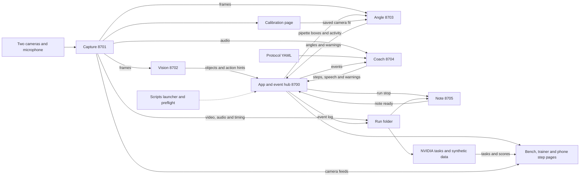

# Bench Coach

Bench Coach uses two cameras and a microphone to follow a pipetting protocol, show the next step, and flag possible technique mistakes. It turns recorded events and speech into a lab note with links back to the video.

Built by the team at the MIT ScienceClaw hackathon, October 30 to November 1, 2026, with AI coding agents. Everything in this repository was written during the hackathon.

## Try it in five minutes

You need Python 3.10 to 3.12 (or [uv](https://docs.astral.sh/uv/), which fetches 3.12 for you) and ffmpeg. The install is about 1.3 GB because the vision models need PyTorch.

```sh
git clone https://github.com/rohitsudhakar1/bench-coach
cd bench-coach
./scripts/setup.sh
export BENCH_PY="$PWD/.venv/bin/python"
./scripts/demo.sh --replay app/samples/demo.jsonl --without capture vision angle coach note
```

Open <http://127.0.0.1:8700> when it prints **Demo ready**. This replays a short recorded session: the step list ticks off, the coach talks, and the camera panels stay empty because no cameras are running. Ctrl-C stops it.

To see the full pipeline, first fetch the model weights while you have good Wi-Fi (about 1.2 GB; it lists each model, its size and licence, then loads each one with the network blocked to prove it works):

```sh
"$BENCH_PY" scripts/fetch_models.py --download
```

Then point it at any two video files of someone pipetting (the team's sample clips are not in the repo):

```sh
./scripts/demo.sh --source left.mp4 right.mp4
```

Choose **Start run**, wait half a minute, choose **Stop run**, then open **Lab note**. With the weights on disk the launcher starts every part offline, so this works with Wi-Fi off. Skip the fetch and the first run downloads them instead, which takes a few minutes and needs a network. Run the tests with `"$BENCH_PY" -m pytest -q`; tests that need the sample clips skip themselves.

## How the parts fit together



The [event contract](docs/EVENTS.md) defines the ports, events and shared Unix epoch clock. Capture writes `cam0.mp4`, `cam1.mp4`, `mic.wav` and `timing.jsonl` to `runs/<run>/`. The hub adds `events.jsonl`, and note builds the lab note when the run stops. Producers print undelivered events to stdout when the hub is down. Each event also carries a `bench` id, which is `"1"` unless classroom mode runs several benches on one hub.

The coach follows the protocol from the event stream, listens through local speech recognition, counts spoken confirmations as "said" evidence, asks about vision hints in hint mode, and warns about reused tips, skipped steps and tilt. On the scripted demo it marked all 8 steps as planned and warned on all 3 planned mistakes; it has not yet been run with real vision, real capture and a real mic together. Speech hearing was tuned on October 31. The coach now opens its noise gate a little sooner and gives Whisper a short list of lab words. Three reused recordings at two speeds and three noise levels went from 12 of 18 right to 18 of 18, but those recordings were also used for the tuning. A larger set made with eight computer voices was only scored for about 100 clips each way, almost all in one voice, and went from 81 of 99 right to 90 of 107. That is a small gain, and the other seven voices are close to unmeasured. See the [voice report](coach/VOICEROBUST-REPORT.md). The launcher skips parts that are missing, so check the part dots on the page before a demo.

## Run the demo

Run from the repository root with the dependencies listed in each part installed. Set `BENCH_PY` to that Python executable, or leave it unset for `python3`. Set `BENCH_SAMPLES` to the folder holding the sample videos, which are not bundled. Fetch model weights beforehand with `scripts/fetch_models.py --download`; `scripts/fetch_models.py --check` proves they load with the network blocked, and preflight repeats that check as its **offline ready** line.

Choose one of these three commands. Stop it with Ctrl-C before starting another.

```sh
# Live cameras and microphone
./scripts/demo.sh --cams 0 1

# Looped sample videos and a silent microphone
./scripts/demo.sh --source "$BENCH_SAMPLES/lsv_mv/CP-Left-Front-414-445.mp4" "$BENCH_SAMPLES/lsv_mv/CP-Right-Front-414-445.mp4"

# Bundled synthetic event replay with no cameras or live producers
./scripts/demo.sh --replay app/samples/demo.jsonl --without capture vision angle coach note
```

Wait for **Demo ready**, then open <http://127.0.0.1:8700>. For live cameras or sample videos, review the protocol, choose **Start run**, then **Stop**, and open **Lab note**. The Lab note tab offers the PDF, a run ZIP, Benchling HTML, an eLabFTW `.eln` archive and a steps CSV. They are built from the saved note with no network call. A real Benchling paste and a real eLabFTW import have not been tried; see the [export report](note/ELNEXPORT-REPORT.md). Check that capture recorded as well as the hub logging events. Logs are in `runs/logs/`, and Ctrl-C stops the launcher's processes. Speaker playback is off by default.

The bundled replay ticks off the first two steps and shows three lines in the conversation. Its angle reading, warning and question reach the event history but not the page, because the page shows those only during a run and a replay has no run. Its camera panels stay empty and it produces no recording or lab note. It does not measure recognition. For a saved log containing run events, use the [app replay guide](app/README.md) with an existing hub instead. The launcher's direct replay retains run events, which the rebuilt hub rejects through its event endpoint.

Angle uses vision's held-pipette boxes by default. Supply `--angle-roi X,Y,W,H` for a manual shaft crop, once per camera used, and `--calibration angle/calibration.json` for your measured camera setup. Without usable calibration, angles are rough image projections. The [launcher guide](scripts/README.md) covers hints, table mode, recorded microphone input and custom ports.

## Views and teaching protocols

Open these paths on the running hub. They share the same run and event history.

| View | What it does |
| --- | --- |
| `/trainer` | Review saved runs by protocol and student, with duration, done/skipped/unsure/unfinished counts, tip reuse and angles over the limit. Select one protocol to see its most missed steps. |
| `/step` | Show the current instruction in large type, the next step, the latest warning and a Done button. Done sends a confirmation to the coach and records said evidence. |
| `/calibrate` | Preview checkerboard corners from both capture feeds, collect pairs, compute a camera fit and save a good result. |
| `/class` | Classroom overview when the launcher runs several benches. One card per bench shows the student, current instruction and last warning, and benches with a warning or an open question come first. Each card opens that bench's own page at `/benches/<id>/`. |

Enter an optional student name on the bench page before Start. Refresh the trainer after a run or note changes. Its missed-step counts include unfinished steps in active runs and reflect recorded outcomes, not measured bench skill. Note links need the note service. See the [trainer guide](app/README.md#trainer-view).

For a physical phone, use the reachable hub address with `/step`. The hub binds to loopback by default; configure its `--host` for the lab network first. It has no authentication. The button waits for the coach to advance the step, so check coach health if it stays waiting. All devices control the same run; avoid confirming from several at once.

For a class, `./scripts/demo.sh --benches 3 ...` starts one capture, vision, angle, coach and note per bench and a single hub. Every bench keeps its own run, history, warnings and recordings. It was checked with three benches on scripted vision and sample videos, where each bench reached all eight step outcomes and kept only its own events. Physical cameras per bench, live speech per bench and more than three benches were not tried. Microphones are silent in classroom mode, so students confirm with their phone's Done button. It has no login. See the [classroom guide](app/README.md#classroom) and the [launcher guide](scripts/README.md#several-benches).

The [teaching library](protocols/README.md) adds five protocols alongside `pipetting-demo.yaml`.

| File in `protocols/` | Exercise |
| --- | --- |
| `serial-dilution.yaml` | Four transfers through prefilled dilution tubes |
| `pcr-master-mix.yaml` | Prepare a common mix for seven reactions with extra volume |
| `heat-shock-transformation.yaml` | Teaching transformation through recovery |
| `loading-gel.yaml` | Load a prepared gel with a ladder and sample |
| `plating-cells.yaml` | Spread recovered teaching cells and incubate |

Select the protocol before starting the run. Each file cites its source and assumptions. Draw and dispense are separate steps; mixing and actions the cameras cannot verify need spoken or Done confirmation. Explicit waits carry `min_seconds`, but an early confirmation only warns and still advances. These exercises add instructions, not new recognition. Review the library and reagent instructions before use.

For calibration, keep capture camera slots 0 and 1 running and open `/calibrate`. Print the linked board with 9 × 6 inner corners at 25 mm spacing. The first captured pose must be level because it defines gravity. Collect at least 12 distinct poses, preferably 20–25 across the views, then choose **Compute** and **Use this calibration** after a good fit. The default destination is `angle/calibration.json`. Restart angle with `--calibration angle/calibration.json` after saving, then complete the physical pencil check. A good image fit does not prove physical tilt accuracy. See the [calibration page guide](app/README.md#camera-calibration-page).

## Vision rules

Angle accepts vision boxes only when their `held` field is explicitly true. Vision requires current hand adjacency and more than 0.5 s of evidence in the last second. Stationary boxes at the frame edge or inferred bench line become unheld after 2 s. Missing held metadata is rejected by angle. This rule exists because vision's pipette box landed on a camera tripod in both 12-27 sample views, and angle then warned about a tilt that was not there. On the cached replay of those clips it took angle's crops on known tripods and other wrong things from 10 to 0. That means angle also measured nothing useful there. The October 31 sweep then found hint mode still warning about 55 and 89 degree tilts with no pipette in hand; since the tilt fix, angle measures only during a draw or dispense with a held pipette and logs readings over 45 degrees instead of warning, and that replay gives no warning. This check leaves draw tracking unchanged; a manual angle ROI remains a separate explicit input.

The tip pick-up rule needs a tip box seen in about the same place on at least three detector runs. Its region extends half its height downward to include tips below the lid. The lower end of an upright pipette enters that region and is later seen out or higher up, producing `tip_on` at most once in 5 s. Tip ejects and touches still use the older rules. A tip event is a visual estimate, not proof that a fresh tip attached.

Vision's `--new-draw` mode sends hints that never complete a step alone. The opt-in vision flag `--dispense-min-dwell 0.4` suppresses dispense hints with less than 0.4 s of dwell, while still flipping the draw/dispense turn. It is off by default. The [dispense report](vision/DISPENSE-REPORT.md) gives precision 0.42 to 0.54 against chance 0.30 to 0.33, but recall falls from 0.45 to 0.32 and right hint questions fall from 8 of 17 to 6 of 15. The scorecard below uses the unchanged default.

`python -m vision --detector` picks the box model. Grounding DINO tiny stays the default. Florence-2 base (`--detector florence2`) draws better boxes on the held-out labelled frames, finding the pipette on 42 of 58 against 38 of 58, with fewer boxes on the wrong thing. But on the held-out clips it made draw and dispense hints worse, down to about what random timing gives (draws found 7 of 18 against 15 of 18 for tiny). It is also too slow for two cameras. On the Mac's GPU, with both cameras sharing one detector, tiny gets 4.04 runs a second per camera and Florence-2 2.15, against a target of 3. Grounding DINO base, OWLv2 and YOLOE were also compared, and each found the pipette less often than tiny. YOLOE is AGPL and is left out of the default install. See the [detector report](vision/DETECTOR2-REPORT.md), the [Florence-2 report](vision/FLORENCE-REPORT.md) and the [speed report](vision/SPEED-REPORT.md).

A small pipette detector was also trained on bench footage. It runs ten times faster and draws far fewer wrong boxes, but the live code found the held pipette on only 30 of 58 held-out frames with it, against 38 of 58 with tiny. It was not adopted. The code and rebuild script are kept in `vision/tipmodel/`; see the [tip model report](vision/TIPMODEL-REPORT.md).

Table mode was reworked to cope with coloured light, dim light, hue shifts, shadows, clutter, shake and a tilted camera. On 60 drawn runs over 15 such conditions it went from 142 of 360 events found to 360 of 360. Those drawn runs were also used while making the changes, so this shows it copes with these pictures, not that it works on a real table. See the [table robustness report](vision/TABLEROBUST-REPORT.md).

## At the table

- [ ] Fix both cameras and confirm that each feed advances. Cover one lens at a time to check their identities. Keep demo ports 8700–8705 available and use 8800–8899 for separate checks.
- [ ] For table mode, bring an overhead camera, tubes A/B/C with red/blue/yellow caps respectively, a tip box, a waste cup, and a matte magenta band near the pipette tip above the liquid-contact area. Fix the rack and camera in place.
- [ ] Follow the [table setup commands](scripts/README.md#table-day). With caps closed and the pipette out of view, save the regions through capture's existing feed. Review every region. Start with `--table` for an overhead view in capture camera slot 0, the default table source. Table mode and hint mode cannot be combined.
- [ ] For physical tilt, follow the [calibration checklist](angle/CALIBRATE.md) with the level checkerboard, then complete the pencil check. Camera order and resolution must match the saved calibration. Do not move cameras afterward. Disable angle for a table-only demo if calibration is not ready.
- [ ] Run the [preflight check](scripts/README.md#table-day) against the running services. It checks fresh feeds, cap and band visibility, calibration, microphone transcription, part health, protocol and free disk. Apply each FIX and rerun. Use `--no-angle`, `--no-table` or `--no-mic` only for deliberately disabled checks.
- [ ] At the prompts, show the magenta band and say “testing”. Preflight needs cached Whisper weights and plays no sound. Open the caps afterward without moving the rack. Review the loaded protocol and its evidence rules, especially combined actions and tube names.
- [ ] Start and stop a short run. Confirm the recordings, lab note, video time links and downloads work. Preflight proves readiness, not recognition accuracy.

## Models, libraries and licences

This table gathers the parts' reported dependencies. The linked guides contain source URLs and details. SDK licences do not grant rights to hosted models, which follow provider terms.

| Part | Models and libraries | Reported licences |
| --- | --- | --- |
| Shared services | Python, FastAPI, Starlette, Pydantic, Uvicorn, HTTPX, websockets, PyYAML, pytest | Python PSF-2.0; FastAPI, Pydantic, PyYAML and pytest MIT; Starlette, Uvicorn, HTTPX and websockets BSD-3-Clause |
| [Capture](capture/README.md) | OpenCV, FFmpeg, NumPy, sounddevice, PortAudio, qrcode, OpenSSL | OpenCV Apache-2.0 with MIT wheel packaging; FFmpeg LGPL-2.1-or-later or GPL depending on build; NumPy and qrcode BSD-3-Clause; sounddevice and PortAudio MIT; OpenSSL 3+ Apache-2.0, older builds under OpenSSL/SSLeay terms |
| [Vision](vision/README.md) | MediaPipe Hand Landmarker, Grounding DINO tiny, Transformers, PyTorch, OpenCV, NumPy, Anthropic SDK; opt-in Grounding DINO base, OWLv2, Florence-2 base and YOLOE; torchvision Faster R-CNN for the unadopted tip model | MediaPipe, Grounding DINO, OWLv2, Transformers and OpenCV Apache-2.0; Florence-2 and Anthropic SDK MIT; PyTorch, torchvision and NumPy BSD-3-Clause; YOLOE (ultralytics) AGPL-3.0, not in the default install |
| [Angle](angle/README.md) | OpenCV LSD, CSRT and stereo calibration; NumPy | OpenCV Apache-2.0; NumPy BSD-3-Clause with bundled notices listed in the part guide |
| [Coach](coach/README.md) | faster-whisper, Whisper small.en, Silero VAD, Anthropic SDK, Google Gen AI SDK, sounddevice, NumPy | Whisper stack, Anthropic SDK and sounddevice MIT; Google SDK Apache-2.0; NumPy BSD-3-Clause; hosted Claude and Gemini under service terms |
| [App](app/README.md) | Shared service libraries; original HTML/CSS/JavaScript; Playwright and Node.js for checks | Playwright Apache-2.0; Node.js MIT with bundled notices; no bundled Tailwind or shadcn code |
| [Note](note/README.md) | Anthropic SDK, OpenCV, NumPy, WeasyPrint, Pango; Poppler for PDF tests | Anthropic SDK MIT; OpenCV Apache-2.0; NumPy and WeasyPrint BSD-3-Clause; Pango LGPL-2.1-or-later; Poppler GPL-2.0-or-later |
| [NVIDIA work](nvidia/README.md) | NeMo Data Designer; Harbor task format; pandas, pyarrow, duckdb, scipy; optional hosted Nemotron | Data Designer and Harbor Apache-2.0; pandas and scipy BSD-3-Clause; pyarrow Apache-2.0; duckdb MIT; Nemotron endpoint under NVIDIA service terms |
| [Scripts](scripts/README.md) | Python launcher; HTTPX, OpenCV, NumPy, PyYAML, websockets and cached faster-whisper for preflight; huggingface_hub, Transformers and MediaPipe for the model fetch and offline check | PSF-2.0, BSD-3-Clause, Apache-2.0 and MIT as listed above |

## Sponsor tools

After Stop, the **Lab note** tab queues **Training tasks (NVIDIA)** automatically. It shows questions, checkers, the offline rules solver score and task ZIP downloads. Each ZIP includes the answer key and reference solution, without recordings or raw speech. This panel works without the note service. **Make synthetic runs** creates 20 runs and compares their skip rates with smoothed recorded rates. It names the engine actually used, either NeMo Data Designer or the local NumPy fallback. A small generated sample can differ greatly from one recorded run. See the [training task guide](app/README.md#training-tasks-in-lab-note).

NVIDIA NeMo Data Designer actually sampled synthetic run settings in the [NVIDIA part](nvidia/README.md), without a key or GPU. It uses a separate environment. Without that library, an explicitly labelled seeded local generator runs instead. The same part exports Harbor-format tasks with answer verifiers. For nine sample tasks the scorecard reports “reference answers 1.00, blank 0.00, offline rules solver 0.89”, against an always 'none' / 'no' baseline of 0.00 in the current scorecard. Those keys reflect recorded events, not independent bench truth. Harbor's CLI and a container run were not tested. Optional Nemotron note generation needs `NVIDIA_API_KEY` and has not been tried live. NeMo Anonymizer, Safe Synthesizer and BioNeMo Framework are not used.

Anthropic Claude supplies optional note wording and a check of vision hints with `ANTHROPIC_API_KEY`. The coach uses it to word answers. Vision checks before/during/after crops in hint mode, but a check never turns a hint into proof. Note checks rewritten numbers and names and falls back to rules on failure. The app also supports optional Claude protocol conversion, and NVIDIA task evaluation can request Claude answers. The part reports describe mocked checks, not successful live API calls.

Google Gemini Live is the coach's optional voice mode, tested only with a stand-in so far, with `--voice gemini-live` and `GEMINI_API_KEY`. Local faster-whisper is the default. Playback requires explicit `--speak`; keep it off during shared-machine checks.

Nebius and NVIDIA Brev are planned GPU hosts only. Vision supports `VISION_DEVICE` for CUDA, MPS or CPU, but the part reports establish no deployment or benchmark on either host.

## Evidence and limits

The current [scorecard](SCORECARD.md) was written on October 31, 2026 at 03.33 EDT. The selected result and chance cells below quote it as written. The capture frame and sample counts move by about one frame between reruns. A dash means no baseline was reported. Precision is the share of events that matched; recall is the share of labelled actions found.

| Check | Data | Result | Chance |
| --- | --- | --- | --- |
| Capture files and silent mic | real | camera 0 90 frames, camera 1 90 (about 97 expected); timing rows match the saved video on both; same-moment gap between the two views median 0 ms, worst 0 ms; audio 48000 samples, rows say 48000 | - |
| Pipette boxes | held-out | 38 of 58 (66%) | - |
| Wrong object boxes | held-out | 130 of 199 boxes on the wrong thing (0.65) | - |
| Default draw | held-out | precision 0.50 (2 of 4); recall 0.11 (2 of 18) | precision 0.30, recall 0.07 |
| Default dispense | held-out | precision 0.67 (2 of 3); recall 0.09 (2 of 22) | precision 0.42, recall 0.06 |
| Draw hints | held-out | precision 0.52 (15 of 29); recall 0.83 (15 of 18) | precision 0.26, recall 0.43 |
| Dispense hints | held-out | precision 0.42 (10 of 24); recall 0.45 (10 of 22) | precision 0.30, recall 0.32 |
| Table mode | synthetic | 27 of 40 runs exactly right; precision 0.95 (389 of 410); recall 0.98 (389 of 395) | precision 0.31 (random events, same count) |
| Coach with real vision | real | 0 of 4 steps done (all 4 really happened); 0 warnings | - |
| Coach with simulated hint replies | held-out | 17 questions (3.1 a minute); about a real action 8 of 17 (47%); ticked 8 of 40 steps | about a real action 0.31 (hints at random times, 50 tries) |
| Note with real vision | real | 1 of 4 steps marked done (all 4 really happened) | - |
| Hub delivery | scripted | 43 of 43 reached a websocket listener, 43 in the same order; 43 in the history; 0.6 ms per post | - |

The newer held-out tip-moment check uses 9 clips and 450 s. Tip pick-up precision is 0.29 (5 of 17), recall 0.31 (5 of 16), against chance precision / recall 0.08 / 0.09. Tip eject precision is 0.00 (0 of 1), recall 0.00 (0 of 13), against 0.00 / 0.00. Touch precision is 0.45 (5 of 11), recall 0.15 (5 of 33), against 0.24 / 0.08. One person labelled moments at 0.5 s intervals, and most ejects happen out of frame, so their times are guesses.

Angle's tuning stills gave “9 of 12 measured; mean error 1.3 deg, worst 4.9 deg; 7 within 2 deg”. Guessing the average angle was off by 21.5 deg. Synthetic stereo gave “791 of 1000 answered; mean error 0.87 deg, 95% under 2.68 deg, worst 5.04 deg”, against guessing 45 deg with about 22.5 deg error. The stills used hand-drawn crops and were used for tuning; stereo assumes correct cameras and shaft lines. Physical calibration and the pencil check remain unmeasured.

The scripted coach check got 8 of 8 step results right and warned on all three planned mistakes; its clean script got 8 of 8 done and 0 warnings. The scripted note matched 8 of 8 step results and built in 3 ms. No chance baseline is reported for those scripts. Protocol conversion classified camera-checkable steps correctly on 23 of 23 and action kinds on 16 of 16 checkable steps; calling every step a draw or dispense gets 16 of 23 on checkable-or-not. Tube names, volumes and timings were not scored.

The scorecard also has a table of numbers quoted from the October 30 and 31 part reports, which its script does not rerun. They cover the detector comparison, GPU speed, the trained tip model, table robustness on drawn runs, the voice checks and the mode sweep. These are small reused sets, not a new independent benchmark. Earlier hint filters were chosen after looking at held-out scores, so those results may be optimistic. General vision cannot name tube A/B/C. Table mode knows saved regions but has only been scored on drawn pictures. Capture timestamps measure delivery, not synchronized exposure, and recording can drop data under load.

Neither camera mode proves liquid transfer, volume, reagent identity or sterility. The note inherits mistakes in events and step tracking. Protocol conversion may treat sub-actions as alternatives. The scorecard does not measure live speech, hosted calls, real cameras, a real bench, real users or the complete demo end to end. Review the evidence labels, warnings and final note before keeping it as a lab record.

## Rehearsal check

`tests/test_rehearsal.py` can fail under heavy load in a full-suite run and is reported to pass on its own. The docs2 isolated check reached the note but failed during launcher shutdown when the sandbox denied a process-group check; see [the docs2 report](docs/REPORT.md). Rerun it alone before treating a suite timeout as a regression. It uses sample video files, a silent mic and scripted vision on check ports in 8800–8899, and skips when `BENCH_SAMPLES` or the required clips are missing. Passing it does not establish real-camera recognition accuracy.

```sh
"${BENCH_PY:-python3}" -m pytest tests/test_rehearsal.py -q -p no:cacheprovider
```

`tests/test_modes_smoke.py` runs every launcher mode the same way (scripted vision, real vision, hints, table on a generated overhead video, three benches and the bundled replay). Each one starts a run, stops it, fetches the note and its downloads and the NVIDIA tasks, opens every page, and checks for tracebacks and port release. All six passed in 111 s on October 31. Without `BENCH_SAMPLES` only replay and table run; real vision and hints also skip when the models are not cached. It checks that the modes work, not that recognition is right. The [sweep report](SWEEP-REPORT.md) has the results and what is still open.

```sh
"${BENCH_PY:-python3}" -m pytest tests/test_modes_smoke.py -q -p no:cacheprovider
```
